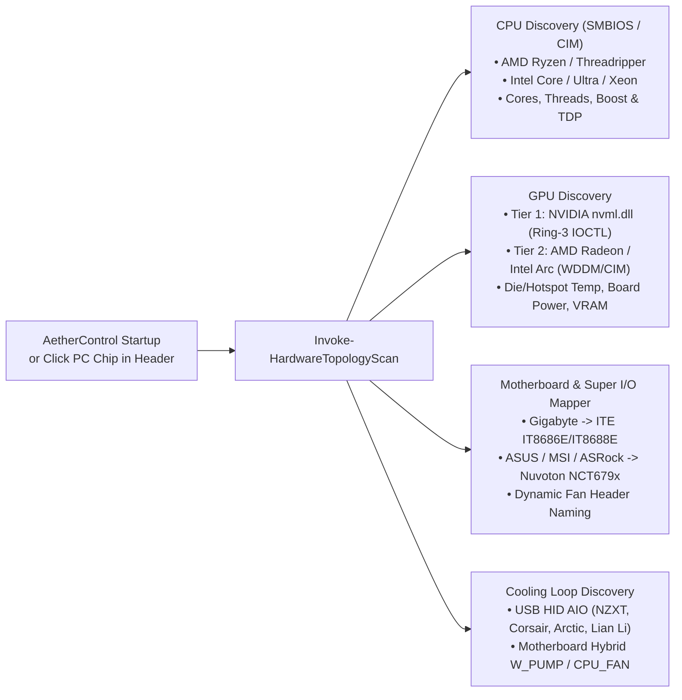

<div align="center">

# AetherControl

**Lightweight Hardware Telemetry, Water Cooling (AIO) & Predictive PWM Fan Controller for Windows**

[-09090B?style=flat-square&logo=windows&logoColor=white)](https://github.com/henriquelaia/AetherControl)
[](docs/ARCHITECTURE.md)
[](#-interactive-3d-digital-twin)
[-10B981?style=flat-square)](#-automated-testing--benchmarking)
[](#)
[%20%7C%20English-F59E0B?style=flat-square)](#)
[](LICENSE)

[**One-Command Install**](#-one-command-install) · [**Hardware Auto-Scanner**](#-universal-hardware-auto-scanner) · [**Architecture**](docs/ARCHITECTURE.md) · [**Supported Hardware**](docs/HARDWARE_SUPPORT.md) · [**Guia em Português (PT-PT)**](#-guia-rápido-em-português-pt-pt)

</div>

---

## Overview

**AetherControl** is a fast, lightweight hardware telemetry and predictive fan control utility for Windows 10 and Windows 11. Built as a clean open-source alternative to heavy vendor suites (*iCUE*, *Armoury Crate*, *Gigabyte Control Center*) and legacy tools (*SpeedFan*, *Afterburner*), it pairs **Ring-3 native C# P/Invoke telemetry (`nvml.dll`, `kernel32.dll`, `user32.dll`)** with a responsive, distraction-free interface supporting both **Light Mode** and **Dark Mode**.

The native C# hardware bridge compiles **in-memory at startup** using Windows' built-in .NET runtime—requiring **zero external SDKs, zero Node.js, and zero background bloatware**. On launch, AetherControl automatically scans your PC's **CPU, GPU, Motherboard Super I/O, RAM, and Water/Air Cooling topology** and configures sensor channels dynamically.

---

## ⚡ One-Command Install

Open **PowerShell** on any Windows 10 or Windows 11 PC and run:

```powershell
irm https://raw.githubusercontent.com/henriquelaia/AetherControl/main/get.ps1 | iex
```

This single command downloads AetherControl into `%LOCALAPPDATA%\AetherControl`, scans your PC hardware, creates the **`AetherControl Studio`** shortcut on your Desktop and Start Menu, and launches the application.

### Manual Clone & Launch
```powershell
git clone https://github.com/henriquelaia/AetherControl.git
cd AetherControl
.\Install-AetherControl.ps1
```
*(Or simply double-click **`Launch-AetherControl.bat`** inside the project folder.)*

---

## Key Capabilities

| Feature | Traditional Vendor Suites | **AetherControl** |
| :--- | :--- | :--- |
| **Hardware Discovery** | Locked to single-vendor hardware | **Universal Auto-Scanner** (Intel/AMD CPUs, NVIDIA/AMD/Intel GPUs, ASUS/MSI/Gigabyte/ASRock Super I/O) |
| **3D Digital Twin** | Static 2D charts only | **Interactive 3D PC Model & Thermal Heatmap** (live CPU/GPU gradient colors, flowing liquid particles & spinning 3D fan blades) |
| **Community Profiles** | Manual trial-and-error tuning | **1-Click Community Profiles Hub** (AIO 360mm Equilibrium, Whisper SFF, Esports 240Hz, Workstation Render) |
| **Modular Plugins** | Closed proprietary ecosystem | **Extensible Plugin Engine** (CSV Flight Recorder, Thermal RGB Sync, Eco Idle Drop, OSD Bridge) |
| **Fan Curve Response** | Reactive only (waits until silicon is already hot) | **Predictive Win32 Process Watchdog** (detects games/3D workloads on launch & pre-ramps airflow before heat soak) |
| **Water Cooling (AIO)** | Requires 1 GB+ background services | **Dedicated Water System Card** (Coolant Temp, Pump RPM, Thermal Saturation, Coolant Sync & 15s Bubble Purge) |
| **GPU Zero-RPM Chatter** | Annoying start/stop fan clicking at `50°C–58°C` | **Zero-RPM Chatter Guard** (maintains a smooth minimum active fan floor) |
| **Acoustic Comfort** | Raw PWM % only | **Decibel Ceiling (`dBA`)** with automatic thermal safety override (`>84°C`) |
| **System Balance** | Raw numbers without context | **Real-Time Bottleneck & Load Balance Engine** (CPU Single-Thread vs. GPU Core vs. VRAM) |
| **Privacy & Safety** | Cloud telemetry & background tracking | **100% Local (`127.0.0.1:5175`)**, zero external network calls, automatic BIOS fan restoration on exit |

---

## 🔍 Universal Hardware Auto-Scanner

When AetherControl starts, `Invoke-HardwareTopologyScan` inspects your hardware across four layers:



Click your detected hardware chip in the top-left navigation bar (or press **`Ctrl + K`** → *Hardware*) at any time to view your full hardware report or re-scan components.

---

## 🧊 Interactive 3D Digital Twin

AetherControl includes a high-performance **3D Digital Twin** running directly in your browser or desktop window at **60 FPS** with **zero garbage-collection memory leaks**:

- **Volumetric 3D Chassis:** Fully interactable 3D PC model with smooth mouse/touch orbit rotation and perspective depth.
- **Dynamic Thermal Heatmap:** The 3D CPU Waterblock and GPU Shroud continuously adjust their color in real-time based on live temperatures (`#06B6D4` Cool Blue $\le 35^\circ\text{C}$ $\rightarrow$ `#10B981` Emerald $\rightarrow$ `#F59E0B` Amber $\rightarrow$ `#F43F5E` Intense Crimson $\ge 84^\circ\text{C}$).
- **Flowing Liquid Coolant Droplets:** Animated AIO coolant particles flow between the CPU block and the 240mm radiator at velocity scaled to live **Pump RPM** (`1200–2800 RPM`).
- **Live 3D Fan Rotors:** 3D front intake fans, top radiator fans, and GPU dual-axial fans spin at the exact live angular velocity of each physical hardware header.
- **3D Streamlines & Modes:** Toggle between **Heatmap**, **Airflow Streamlines**, and **CAD Wireframe** modes. Hovering over any 3D component reveals its live temperatures, power draw, and fan speeds in a real-time HUD callout.

---

## 🌐 Community Profiles & Modular Plugin API

- **Community Profiles Hub (`/api/community/profiles`):** Browse and 1-click apply tested fan curves submitted by enthusiasts (*HydroLoop 360mm Equilibrium*, *Whisper SFF Zero-Resonance*, *Competitive 240Hz Boost Lock*, *Workstation 24/7 Render Node*).
- **Extensible Plugin Engine (`/api/plugins`):**
  - **Thermal RGB Gradient Sync:** Synchronizes ARGB / 3D twin lighting with live component temperatures.
  - **Blackbox CSV Telemetry Logger:** Records high-resolution 1Hz traces (`Timestamp, CpuTemp, GpuTemp, CoolantTemp, PumpRpm, PWM`) to `%LOCALAPPDATA%\AetherControl\logs\telemetry.csv`.
  - **Eco Idle Acoustic Drop:** Drops pump and fan speeds when the PC enters an idle state.
  - **In-Game HUD Telemetry Bridge:** Low-latency JSON feed for overlays and secondary sensor monitors.

---

## 🧪 Automated Testing & Benchmarking

Verify the full telemetry engine, hysteresis solver, liquid thermal model, and API memory stability with the built-in test suite:

```powershell
.\tests\Invoke-AetherTestSuite.ps1
```

```text
================================================================================
  AETHERCONTROL // AUTOMATED UNIT, INTEGRATION & MEMORY BENCHMARK SUITE
================================================================================
  [PASS] Hardware Auto-Scanner (CPU/GPU/RAM/Storage/SuperIO)
  [PASS] Real-Time Telemetry Snapshot & 4-Channel PWM Binding
  [PASS] Per-Channel Fan Identify Spin-Up Override (100%)
  [PASS] Community Profiles Catalog Loaded (4 curated profiles)
  [PASS] Community Profile 1-Click Apply & Coolant Sync
  [PASS] Modular Plugin API Toggle State
  [PASS] Settings Persistence & JSON Profile Export
  [PASS] Telemetry Polling Latency & Zero Memory Leak Benchmark (AvgLatency=2.54ms/req, Delta=0MB)
--------------------------------------------------------------------------------
  SUMMARY: 8 Passed, 0 Failed
================================================================================
```

---

## 🇵🇹 Guia Rápido em Português (PT-PT)

O **AetherControl** inclui suporte nativo para **Português Europeu (`PT-PT`)** e **Inglês (`EN`)**, com estimativa de consumo elétrico em tempo real (`W` e `€/mês`).

### Instalação num Único Comando
Abra o **PowerShell** e cole:
```powershell
irm https://raw.githubusercontent.com/henriquelaia/AetherControl/main/get.ps1 | iex
```

1. **Modos Rápidos no Topo:** Alterne com um clique entre **Silencioso**, **Equilibrado**, **Gaming**, **Trabalho** e **Máximo**.
2. **Modo Claro / Escuro:** Clique no botão **☀️ / 🌙** no canto superior direito para alternar entre o tema claro e o tema escuro.
3. **Sistema de Água (AIO):** Veja sempre no ecrã principal a temperatura da água (`°C`), velocidade da bomba (`RPM`), saturação térmica, modo da bomba (**Calmo**, **Normal**, **Máx**), sincronização pelas ventoinhas e o botão **Purgar Bolhas**.
4. **Curva de Velocidade das Ventoinhas:** Arraste qualquer um dos 5 pontos (`P1`–`P5`) no gráfico para ajustar a velocidade das ventoinhas para cada temperatura.
5. **Desligar em Segurança:** Clique (ou mantenha premido) no botão vermelho **`Sair`** no canto superior direito ou execute [`Stop-AetherControl.bat`](Stop-AetherControl.bat) para encerrar o serviço e devolver o controlo à BIOS.

---

## 📚 Documentation & Guides

- [**System Architecture & Engineering Spec (`docs/ARCHITECTURE.md`)**](docs/ARCHITECTURE.md) — C# P/Invoke interop, hysteresis solver, liquid thermal inertia model, and local REST API reference.
- [**Supported Hardware Matrix (`docs/HARDWARE_SUPPORT.md`)**](docs/HARDWARE_SUPPORT.md) — Supported CPUs, GPUs, Super I/O chips, and AIO liquid coolers.
- [**Complete User Guide — PT-PT & EN (`docs/USER_GUIDE_PT_EN.md`)**](docs/USER_GUIDE_PT_EN.md) — Full step-by-step manual in Portuguese and English.
- [**Contributing Guide (`CONTRIBUTING.md`)**](CONTRIBUTING.md) — How to add motherboard Super I/O mappings, game profiles, or translations.

---

## License

Distributed under the **MIT License**. See [`LICENSE`](LICENSE) for details.
