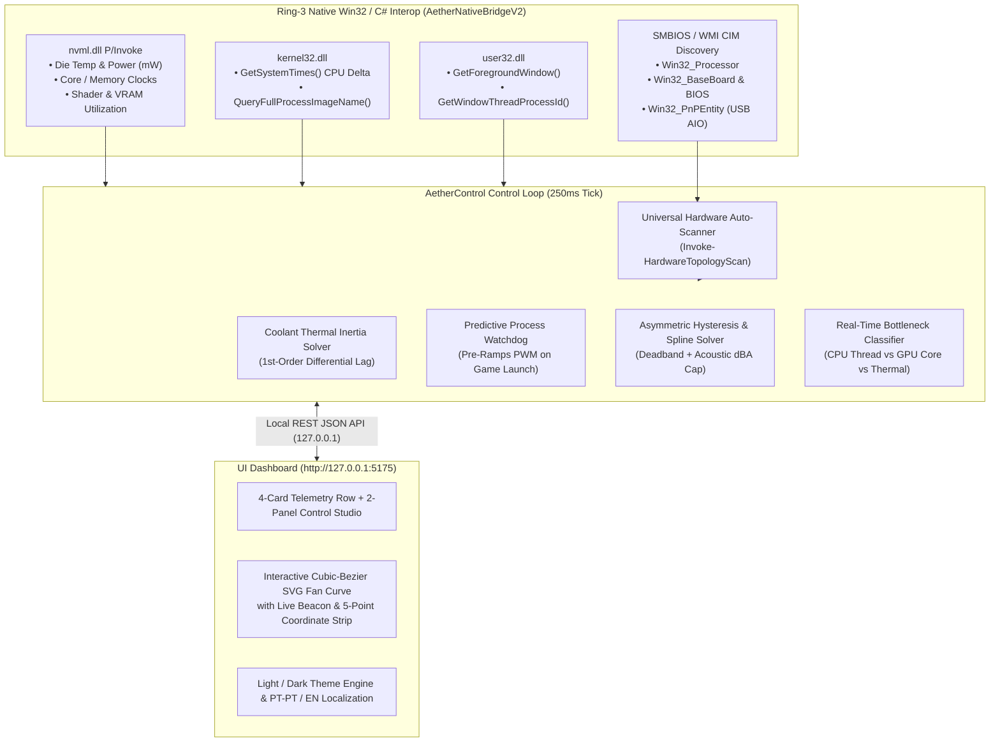

# AetherControl — System Architecture & Engineering Specification

This document describes the internal architecture of **AetherControl**, detailing how it performs low-overhead hardware telemetry, zero-dependency startup on Windows 10/11, and smooth thermal fan control.

---

## 1. End-to-End Architecture

---

## 2. In-Memory C# Compilation

Traditional Windows hardware utilities require installing specific runtime bundles or heavy Electron frameworks.

**AetherControl** embeds `AetherNativeBridgeV2` (C# `[DllImport]` P/Invoke bindings for `nvml.dll`, `kernel32.dll`, and `user32.dll`) directly inside [`AetherControl-NativeDaemon.ps1`](../AetherControl-NativeDaemon.ps1) and compiles it into memory at startup via `Add-Type -Language CSharp`.

- **Startup Compilation Time:** `< 180 ms`
- **Memory Footprint:** `~45–85 MB`
- **Local-Only HTTP Server:** Binds strictly to `127.0.0.1:5175` (`localhost`) using `HttpListener.BeginGetContext` with a `200ms` wait handle so `Ctrl+C` and `/api/daemon/shutdown` exit cleanly.

---

## 3. Thermal Control Models

### 3.1 Asymmetric Hysteresis Deadband
To prevent rapid fan speed oscillation when CPU temperature spikes briefly during short workloads, AetherControl applies an asymmetric directional deadband $D_h$ (default `3.0 °C`):

$$T_{\text{eff}}(t) = \begin{cases} T_{\text{raw}}(t) & \text{if } T_{\text{raw}}(t) \ge T_{\text{eff}}(t-1) \quad \text{(Immediate step-up)} \\ T_{\text{raw}}(t) & \text{if } T_{\text{eff}}(t-1) - T_{\text{raw}}(t) \ge D_h \quad \text{(Delayed step-down)} \\ T_{\text{eff}}(t-1) & \text{otherwise} \end{cases}$$

### 3.2 Water Cooling (AIO) Thermal Inertia Model
Water has a high specific heat capacity ($4.184\text{ J/(g}\cdot^\circ\text{C)}$), warming and cooling much more gradually than a silicon die. AetherControl models steady-state coolant temperature $T_{\text{eq}}$ from total loop heat load and radiator airflow:

$$T_{\text{eq}} = T_{\text{ambient}} + 0.068 \cdot (P_{\text{CPU}} + 0.25 P_{\text{GPU}}) - 0.045 \cdot \text{PWM}_{\text{smooth}}$$

$$T_{\text{coolant}}(t) = T_{\text{coolant}}(t-1) + \alpha \cdot \left(T_{\text{eq}} - T_{\text{coolant}}(t-1)\right)$$

Enabling **Sync to water (`Guiar pela água`)** drives radiator fans from liquid temperature instead of short CPU spikes.

### 3.3 Acoustic Decibel Ceiling (`dBA`)
AetherControl maps target PWM % to estimated acoustic output ($\text{dBA}$) and enforces the configured `maxAllowedDbCeiling` (default `38.5 dBA`), unless silicon temperature reaches the safety cutoff (`84.0 °C`), where full cooling is automatically unlocked.

---

## 4. Local HTTP REST API Reference

| Endpoint | Method | Description |
| :--- | :--- | :--- |
| `/api/telemetry` | `GET` | Returns real-time hardware telemetry, fan channels, water cooling status, bottleneck analysis, and energy cost. |
| `/api/hardware/scan` | `GET` | Runs or returns the hardware auto-scanner topology (`?refresh=1` forces a fresh scan). |
| `/api/fan/preset/{name}` | `POST` | Activates a curve preset (`Silent`, `Balanced`, `Predictive Gaming`, `Heavy Compute`, `Max Cooling`). |
| `/api/fan/config` | `POST` | Updates custom spline curve nodes, temperature source, hysteresis deadband, or manual PWM override. |
| `/api/liquid/config` | `POST` | Sets AIO pump mode (`Silent`, `Balanced`, `Extreme`), coolant sync, or triggers the 15s bubble purge. |
| `/api/gpuguard/config` | `POST` | Configures the GPU Zero-RPM Chatter Guard minimum active fan floor (%). |
| `/api/predictive/rules` | `GET / POST / DELETE` | Lists, adds, or deletes Win32 foreground application pre-cooling rules. |
| `/api/acoustic/config` | `POST` | Updates the maximum allowed decibel (`dBA`) ceiling. |
| `/api/daemon/shutdown` | `POST` | Stops the daemon and restores fan control to motherboard BIOS/UEFI. |
