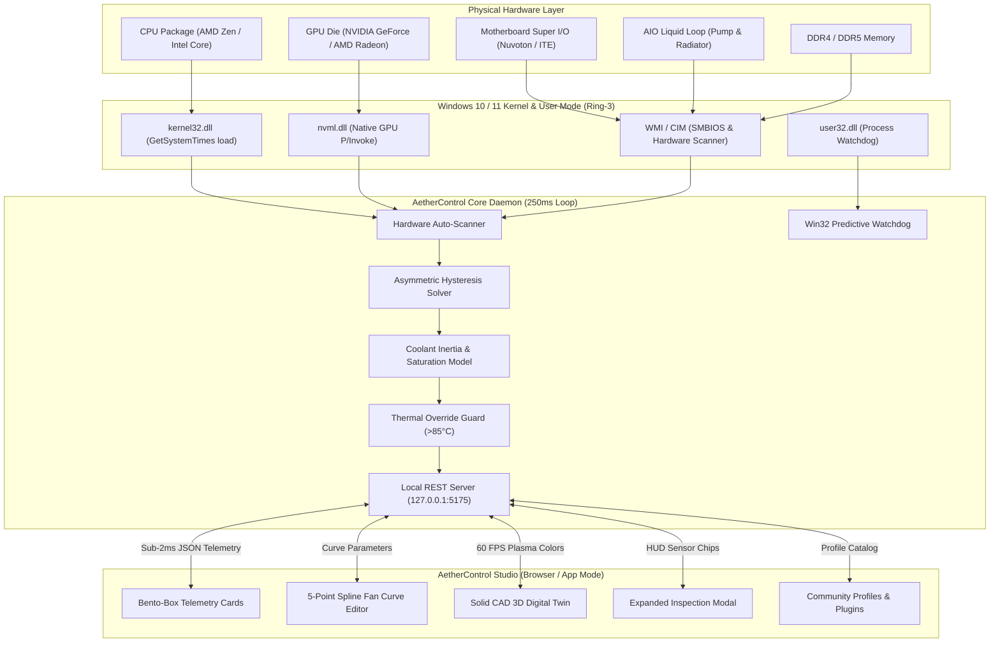
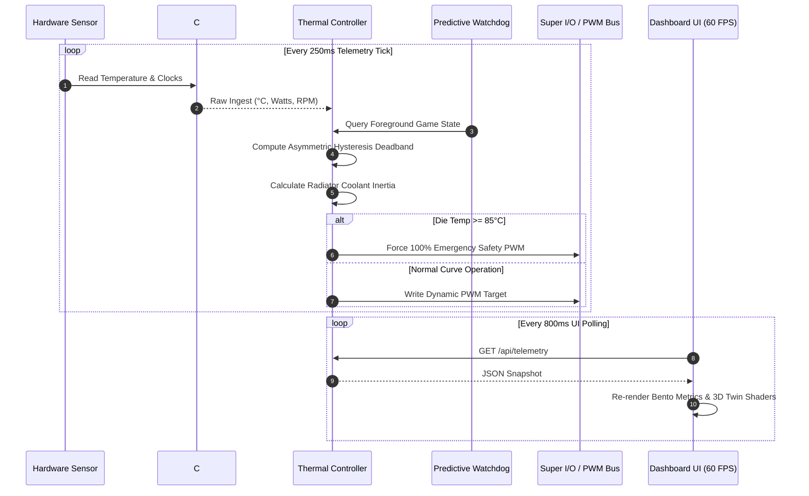
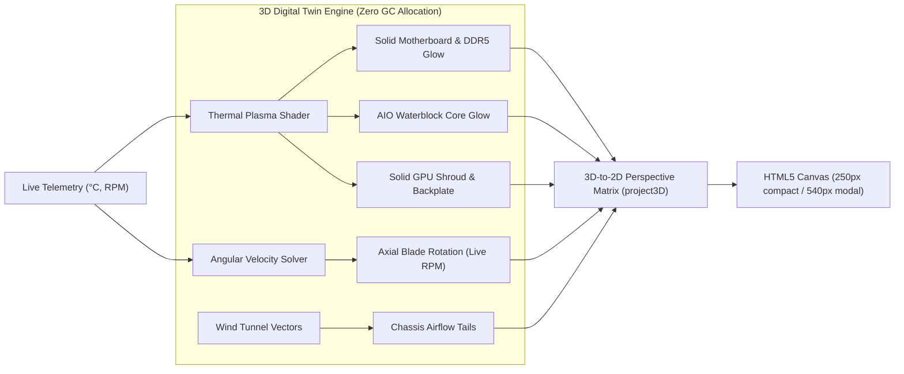
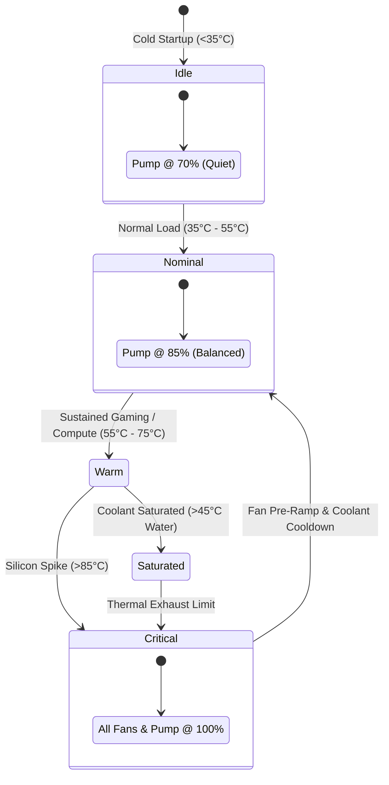

# AetherControl — Visual Architecture & Process Diagrams

This document contains comprehensive visual diagrams detailing the architecture, hardware telemetry loops, thermal state machine, and 3D digital twin rendering pipeline of **AetherControl**.

---

## 1. High-Level System Architecture

---

## 2. Telemetry Ingestion & Fan Curve Lifecycle

---

## 3. Solid CAD 3D Digital Twin Rendering Pipeline

---

## 4. Liquid Cooling (AIO) Thermal State Machine

