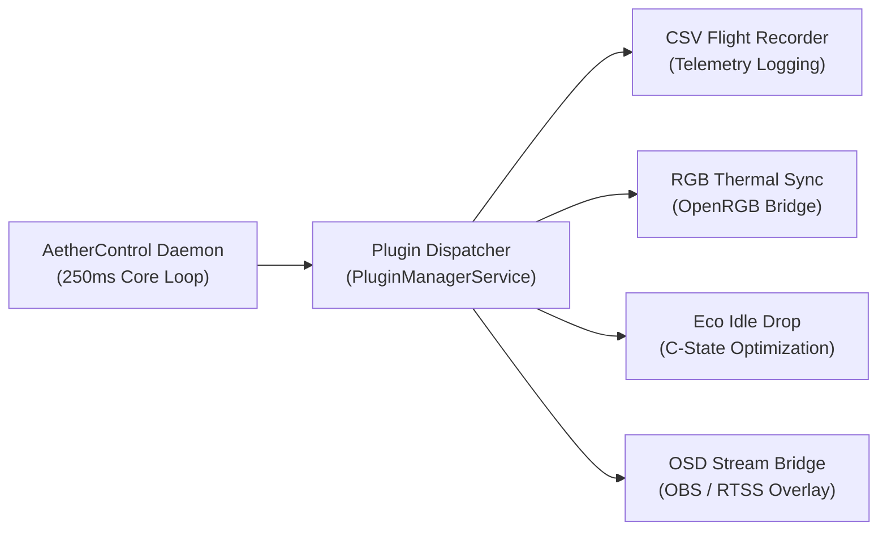

# AetherControl — Modular Plugin Development Guide

AetherControl v3.0+ features an open, lightweight plugin architecture allowing developers to extend telemetry capture, integrate lighting controllers, or bridge hardware states to streaming software.

---

## 1. Plugin Architecture

Plugins run in user-space and receive telemetry state changes via events from the core daemon.



---

## 2. Plugin Specification (`plugin.json`)

Every plugin contains a manifest file defining metadata, capabilities, and settings schema:

```json
{
  "id": "rgb-thermal-sync",
  "name": "RGB Thermal Reactive Sync",
  "version": "1.0.0",
  "author": "Community Contributor",
  "description": "Translates live GPU and CPU thermal envelopes to OpenRGB motherboard headers.",
  "entrypoint": "plugin.ps1",
  "capabilities": ["telemetry:read", "hardware:rgb"],
  "settings": {
    "targetDevice": "Motherboard",
    "coolColor": "#06B6D4",
    "hotColor": "#F43F5E"
  }
}
```

---

## 3. Hooking into Telemetry Events

In `plugin.ps1`, your script handles the `On-TelemetryTick` callback:

```powershell
param(
    [PSCustomObject]$Telemetry
)

# Access sensor telemetry directly
$cpuTemp = $Telemetry.cpu.tempC
$gpuTemp = $Telemetry.gpu.tempC
$coolant = $Telemetry.cooling.coolantTempC

# Execute custom extension logic
if ($cpuTemp -gt 75.0) {
    # e.g., trigger RGB alert or append to flight log
}
```

---

## 4. Contributing Your Plugin

1. Fork the [AetherControl repository](https://github.com/henriquelaia/AetherControl).
2. Place your plugin directory in `src/Plugins/<your-plugin-id>/`.
3. Submit a Pull Request with unit tests and documentation.
